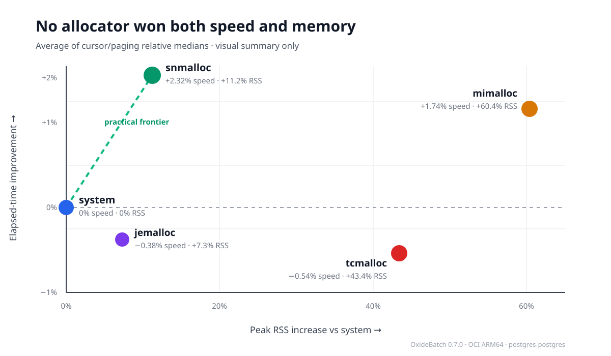
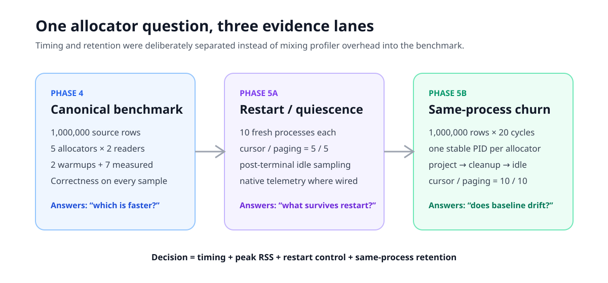
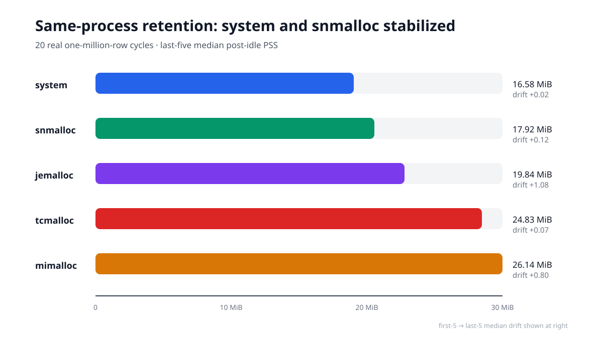
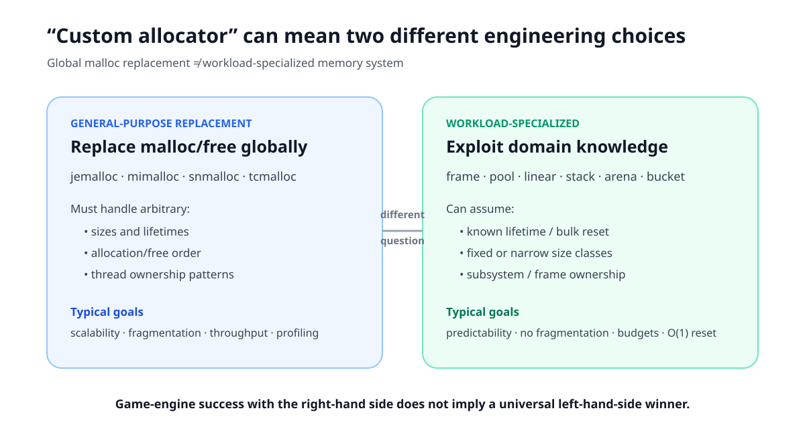

# Are Custom Rust Allocators Actually Faster?

When Rust server or batch performance comes up, names such as `jemalloc`, `mimalloc`, `snmalloc`, and `tcmalloc` appear quickly.

That makes an intuitive hypothesis tempting:

> If I replace the system allocator with a purpose-built allocator, shouldn't the program get faster and use less memory?

I had the same question for OxideBatch. Rather than changing the default based on reputation, I compared five allocators on the same real PostgreSQL-backed batch workload and looked at elapsed time, peak RSS, restart/quiescence behavior, and same-process retention.

The result was less dramatic than expected.

**No allocator improved both elapsed time and RSS.**

The scatter plot uses simple cursor/paging averages only as a visual summary. The decision itself uses the original reader-specific measurements below.

## The short version

The campaign ended with three practical conclusions.

- **Keep the system allocator as the default.**
- **Use snmalloc as an opt-in performance choice when extra memory is acceptable.**
- **The current evidence does not justify making jemalloc, mimalloc, or tcmalloc the default for this workload.**

That is not the same as saying custom allocators are useless.

The stronger conclusion is that allocator choice was not the dominant bottleneck in this workload, and every alternative bought one property by spending another.

## What I measured

This was not an allocator microbenchmark. The subject was OxideBatch's real PostgreSQL representative workload.

The claim-bearing environment was fixed to:

- OxideBatch: exact published `0.7.0`
- target: `aarch64-unknown-linux-gnu`
- host: OCI ARM64 `VM.Standard.A1.Flex`
- CPU: 4 OCPU
- RAM: 24 GB
- filesystem: ext4
- swap: off
- PostgreSQL: 18 series
- candidates: `system`, `jemalloc`, `mimalloc`, `snmalloc`, `tcmalloc`

The campaign was split into multiple lanes instead of trusting one benchmark number.

### Phase 4: canonical repeated benchmark

This lane supplied the authoritative timing comparison.

- source rows: 1,000,000
- seed: 20260904
- chunk: 1,000
- cursor fetch: 500
- paging page: 750
- warmups: 2 per reader
- measured repetitions: 7 per reader
- five allocators × two readers
- 70/70 measured manifests passed
- 20/20 warmup correctness checks passed
- 140 retained raw-artifact hashes verified
- outliers were identified but not silently removed

The comparison therefore uses distributions on the same dataset and host rather than a single lucky run.

### Phase 5A: restart / quiescence

Every iteration started a fresh workload process. Ten iterations per allocator retained a post-terminal quiescence interval.

This lane separated process-local allocator state from durable database, metadata, and filesystem state.

### Phase 5B: same-process churn

This was the key follow-up.

For each allocator, one process stayed alive while running the real one-million-row job **20 times**.

Each cycle followed this shape:

`run → verify 1,000,000 projected rows → clean business rows → idle → sample process/native memory`

Cursor and paging alternated 10:10. The point was not benchmark timing; it was to see whether the post-cleanup/post-idle baseline kept climbing while the allocator process stayed alive.

## Phase 4: there was no free lunch

Median elapsed times were:

| allocator | Cursor median | Paging median | Relative to system |
| --- | ---: | ---: | --- |
| system | 16.6972s | 16.6566s | baseline |
| snmalloc | **16.2908s** | **16.2901s** | **2.43% / 2.20% faster** |
| mimalloc | 16.3696s | 16.4029s | 1.96% / 1.52% faster |
| jemalloc | 16.7104s | 16.7673s | 0.08% / 0.67% slower |
| tcmalloc | 16.6922s | 16.8399s | 0.03% faster / 1.10% slower |

On timing alone, snmalloc won.

Peak memory changed the picture.

Median max RSS relative to system:

| allocator | Cursor max RSS | Paging max RSS |
| --- | ---: | ---: |
| system | baseline | baseline |
| snmalloc | **+13.2%** | **+9.2%** |
| jemalloc | +8.4% | +6.2% |
| tcmalloc | +41.3% | +45.4% |
| mimalloc | **+58.5%** | **+62.3%** |

So **none of the custom allocators won on both speed and RSS.**

snmalloc bought roughly two percent less elapsed time with roughly ten percent more peak RSS. mimalloc was somewhat faster but paid a very large memory premium. tcmalloc used much more memory without a consistent timing gain. jemalloc was essentially tied with system on elapsed time while using more memory.

For this workload, the practical Pareto frontier was basically system versus snmalloc.

## Was the allocation/free pressure strong enough?

A reasonable challenge to Phase 4 is:

> Maybe the workload simply did not allocate and free enough objects to expose allocator differences.

That is why Phase 5B exists.

The same-process lane ran the actual one-million-row job twenty times without restarting the allocator process. Real workload allocations from strings, transformed rows, projection/bind data, and repeated source-digest work remained in the path.

After each cycle the business projection was cleaned, the process idled for one second, and process memory plus allocator-native telemetry was captured.

Post-idle PSS behaved as follows:

| allocator | first-5 median | last-5 median | median drift | late-10 slope |
| --- | ---: | ---: | ---: | ---: |
| system | 16.56 MiB | 16.58 MiB | +0.02 MiB | +0.001 MiB/cycle |
| snmalloc | 17.79 MiB | 17.92 MiB | +0.12 MiB | +0.003 MiB/cycle |
| jemalloc | 18.76 MiB | 19.84 MiB | +1.08 MiB | +0.143 MiB/cycle |
| tcmalloc | 24.76 MiB | 24.83 MiB | +0.07 MiB | 0.000 MiB/cycle |
| mimalloc | 25.34 MiB | 26.14 MiB | +0.80 MiB | +0.131 MiB/cycle |

snmalloc's native `current_memory_usage` and `peak_memory_usage` showed zero median drift between the first-five and last-five windows.

For this OxideBatch workload, that removes the main suspicion that snmalloc's timing advantage was hiding sustained process-local memory growth.

jemalloc's live allocated bytes were nearly flat, while its OS-visible resident/mapped footprint did not clearly plateau within twenty cycles. That is a reason for caution, not proof of a leak.

mimalloc also had a high absolute footprint and mild late-cycle upward drift. Again, this is not enough to call it a leak.

### This still was not an allocator torture test

The scope matters.

The campaign answered:

**“Which allocator makes sense for this real OxideBatch workload?”**

It did not deliberately construct allocator-specific extremes such as:

- many threads hammering small allocations concurrently
- cross-thread allocate/free patterns
- one hot size class at extremely high operation rates
- randomized object lifetimes designed to maximize fragmentation
- NUMA
- huge-allocation release behavior
- allocator-operation P99/P999 latency

The results therefore do not mean “snmalloc is two percent faster for all Rust programs” or “mimalloc always costs sixty percent more RSS.”

But an allocator torture suite is also not the primary evidence needed to choose OxideBatch's default. A default should be justified by representative workload evidence.

## Why did “custom allocator must be better” feel so plausible?

I expected a custom allocator to win somehow too. That intuition is especially natural if you have worked in game development, where custom memory systems are common and sometimes absolutely necessary.

There is real history behind the intuition.

In 2011 Facebook described jemalloc as a response to concrete production problems in large multithreaded server workloads: allocation/deallocation throughput, predictable fragmentation, and heap profiling all mattered operationally.

- [Meta/Facebook: Scalable memory allocation using jemalloc (2011)](https://engineering.fb.com/2011/01/03/core-infra/scalable-memory-allocation-using-jemalloc/)

Rust itself used jemalloc as the default allocator on several major platforms for years because it often performed better than the system allocator.

Then Rust 1.32 switched back to the system allocator. The release notes are revealing: jemalloc usually performed well, **but not always**, while also carrying binary-size, platform, and maintenance costs.

- [Rust 1.32: jemalloc is removed by default (2019)](https://blog.rust-lang.org/2019/01/17/Rust-1.32.0/)

That history alone argues against a universal allocator winner.

The other important change is that **system allocators did not stand still.**

glibc 2.26 added a per-thread malloc cache. Small allocation/free fast paths can be served without locks, and the glibc change explicitly reported meaningful gains across captured workloads.

- [glibc 2.26: Add per-thread cache to malloc (2017)](https://sourceware.org/pipermail/glibc-cvs/2017q3/062648.html)
- [Current glibc malloc tunables](https://sourceware.org/glibc/manual/latest/html_node/Memory-Allocation-Tunables.html)

So it is misleading to compare a 2026 glibc baseline with a mental model of “slow system malloc” formed in the 2000s or early 2010s.

The system baseline in this experiment is not a naïve allocator. It already has arenas, per-thread caching, fast paths, mmap/trim behavior, and decades of engineering behind it.

## “Custom allocator” in game development can mean a different thing

This is the most important bridge between the OxideBatch result and prior game-industry experience.

The phrase “custom allocator” often conflates two different categories.

### 1. Replacing the general-purpose allocator

This is what the OxideBatch campaign compared:

- system/glibc malloc
- jemalloc
- mimalloc
- snmalloc
- tcmalloc

These are **general-purpose allocators**. They must accept diverse sizes, lifetimes, and free orders, so they cannot assume much about the application.

TCMalloc reduces contention through per-CPU/per-thread caches. snmalloc specifically targets difficult cross-thread frees and batched remote deallocation with a message-passing design. mimalloc describes itself as a general-purpose allocator and explicitly notes that no allocation algorithm is optimal for every possible workload.

- [Google TCMalloc design](https://google.github.io/tcmalloc/design.html)
- [Microsoft snmalloc](https://github.com/microsoft/snmalloc)
- [Microsoft mimalloc](https://github.com/microsoft/mimalloc)
- [jemalloc](https://jemalloc.net/)

### 2. A workload-aware specialized allocator

This is much closer to what game engines often mean.

Unity's current native memory system does not pick one universal allocator. It routes allocations by **lifetime and use case**.

- persistent allocations: dynamic heap / bucket allocators
- small allocations: fixed-size lock-free buckets
- temporary allocations: TLS stack allocators
- short-lived job buffers: threadsafe linear allocators

Unity's own documentation frames allocator configuration as a speed-versus-memory trade: memory-rich applications may favor faster, more memory-hungry configurations while memory-constrained applications may prefer efficiency.

- [Unity Native Allocators](https://docs.unity3d.com/Manual/performance-native-allocators.html)

Unreal Engine exposes allocators such as `FMallocBinned2`, documented as an optimized virtual-memory allocator. EA's EASTL made allocator control an explicit part of its game-development design, and its fixed-size containers can use contiguous fixed pools to avoid fragmentation and make allocation cheap.

- [Unreal Engine FMallocBinned2](https://dev.epicgames.com/documentation/en-us/unreal-engine/API/Runtime/Core/FMallocBinned2)
- [EASTL Design](https://github.com/electronicarts/EASTL/blob/master/doc/Design.md)

CryEngine globally remaps `new/delete` to its heap allocator and connects allocation discipline with module-level memory budgets and tracking.

- [CRYENGINE C++ Coding Standard — Memory allocation](https://www.cryengine.com/docs/static/engines/cryengine-5/categories/23756813/pages/25530454)

Those systems are not merely chasing a better malloc benchmark. They can optimize around information that a general-purpose allocator does not have:

- “all of this temporary memory dies at the end of the frame”
- “all objects in this pool are the same size”
- “this level arena can be discarded as a unit”
- “this subsystem owns a fixed memory budget”
- “a console build must make worst-case memory behavior predictable”
- “the render frame must not unexpectedly enter a slow general-heap path”

Older Molecule Engine articles make the same point with linear and LIFO allocators for known lifetimes such as level loading. The allocator supports fewer operations, and **that restriction is exactly what makes it simpler and faster.**

- [Molecular Musings: linear allocator](https://blog.molecular-matters.com/2012/08/14/memory-allocation-strategies-a-linear-allocator/)
- [Molecular Musings: growing LIFO allocator](https://blog.molecular-matters.com/2013/01/29/memory-allocation-strategies-a-growing-stack-like-lifo-allocator/)

There are also concrete production stories where fragmentation, not raw malloc throughput, was the problem. Insomniac publicly described a case where many hours of play fragmented a heap enough that full-screen movie playback could no longer reliably obtain the large contiguous block it needed.

- [Game Developer: The Dalton Allocator — Insomniac Games](https://www.gamedeveloper.com/programming/dirty-game-development-tricks)

Naughty Dog's GDC session on getting The Last of Us Remastered to 60 FPS on PlayStation 4 likewise treated memory allocation patterns alongside the job system and lock strategy.

- [GDC: Parallelizing the Naughty Dog Engine Using Fibers](https://www.gdcvault.com/play/1022186/)

So “we used custom allocators in games and they mattered” is entirely compatible with the result here.

**A game engine can exploit lifetime and structure information that a general-purpose malloc replacement does not have.**

A frame allocator that accepts a bulk reset can obviously beat a general-purpose allocator on that specific problem because it gives up arbitrary free order and generality.

## Why allocator anecdotes contradict each other so dramatically

Allocator discussions in developer communities can look almost absurdly inconsistent.

One developer reports that swapping the allocator stopped an OOM pattern and dramatically reduced CPU usage. A 2026 r/rust thread describes a long-running Ubuntu service whose memory behavior stabilized after switching away from the system allocator.

- [r/rust: Allocator has a high impact on your Rust programs](https://www.reddit.com/r/rust/comments/1riwbqv/perf_allocator_has_a_high_impact_on_your_rust/)

But when mimalloc was discussed on Hacker News in 2019, a ClickHouse developer reported that mimalloc was initially around twice as slow as jemalloc for their common workload. After work with the allocator developer, the gap improved substantially.

- [Hacker News: Mimalloc — ClickHouse workload discussion](https://news.ycombinator.com/item?id=20249743)

These reports do not have to contradict each other.

Allocator behavior is unusually sensitive to:

- single-threaded vs highly parallel execution
- whether objects are freed by the allocating thread or another thread
- object-size distribution
- lifetime distribution
- burst allocation/free behavior
- thread and CPU counts
- page size, huge pages, and NUMA
- how aggressively freed pages need to return to the OS
- whether throughput, tail latency, or peak RSS is the real objective

The mimalloc project itself explicitly warns that no general-purpose allocation algorithm is optimal for every possible workload and that synthetic benchmarks may not represent real applications.

TCMalloc's tuning guidance exposes the same trade directly: larger caches reduce trips to central structures and can improve performance, but naturally allow more memory to remain cached.

That is almost exactly what the OxideBatch result looked like.

`snmalloc` spent more memory for a modest timing improvement, while `system` delivered a smaller footprint with already-good performance.

## Misconceptions and what the evidence actually says

| Common belief | Better interpretation |
| --- | --- |
| A custom allocator is faster than the system allocator | **It depends on the workload.** Rust itself stopped forcing jemalloc as the default. |
| A custom allocator also uses less memory | Fast caching/reservation policies can increase RSS. |
| System malloc is old and simplistic | Modern glibc has arenas, tcache, fast paths, and mmap/trim policies. |
| Games use custom allocators because generic allocators are simply bad | Game engines often rely on **lifetime-aware pool/linear/stack allocators**, which solve a different problem. |
| RSS that does not fall immediately after free means a leak | Allocator caches, fragmentation, resident pages, and purge policy can all retain RSS without a live-object leak. |
| The microbenchmark winner will win in my application | Size, lifetime, thread, and page patterns can completely reorder the result. |
| Specialized allocators are obsolete | They can be extremely effective when the application can impose strong lifetime/size restrictions. |
| Global allocator replacement is pointless | It can be a huge win when fragmentation or allocation contention is a real bottleneck — but only measurement can establish that. |

This table is the right lens for the OxideBatch result.

The system allocator winning the balanced decision does not mean custom allocator engineering is obsolete.

**It means that, for this workload, replacing one general-purpose allocator with another did not buy enough to justify a new default.**

There is one more useful scope boundary. This workload ran on four ARM64 OCPUs and a PostgreSQL-backed batch path. The campaign did not separately instrument how often allocations were freed by another thread or how strongly the workload exercised thousands of remote frees, nor did it create a large-core contention scenario specifically for TCMalloc.

That matters because those are exactly the kinds of patterns some alternative allocators are designed to excel at.

So the most precise interpretation is:

> This benchmark was not designed to find a pathological workload where each allocator shines. It was designed to ask whether OxideBatch's representative workload actually needs one of them.

The answer was: not enough to change the default.

## So why do custom allocators exist?

The result initially felt strange.

If custom allocators are sophisticated, why did none of them simply beat the system allocator everywhere?

The expectation was wrong.

An allocator is not necessarily trying to be a universal drop-in that is simultaneously faster, smaller, less fragmented, more scalable, and lower latency for every allocation pattern.

Allocator policies trade resources against each other. A design can keep more memory in local caches or reservations to reduce contention or allocation latency. Another can optimize a particular object-lifetime or concurrency pattern. Those policies only pay off when the workload actually exercises them.

The more useful question is not:

> Which allocator is better?

It is:

> **Which cost does my workload care about most?**

For this workload, that leads to a straightforward classification.

### system

It had the lowest observed memory footprint and the flattest long-lived baseline.

It was not the fastest, but the gap was small, and it adds no allocator-specific dependency or target policy to the framework default.

That is why it stays the default.

### snmalloc

This was the only clearly useful performance option.

It was more than two percent faster in both cursor and paging runs, and same-process retention stabilized well.

The cost was roughly 9–13% higher peak RSS.

If memory headroom exists and reducing batch duration has real value, that is a legitimate trade.

### jemalloc

For this workload, elapsed time was effectively the same as system.

It used more RSS and showed some remaining OS-visible footprint drift in Phase 5.

“It's a server, so use jemalloc” was not supported by this evidence.

### mimalloc

It gained roughly 1–2% in timing while increasing peak RSS by roughly 58–62%.

That trade did not make sense for this workload.

### tcmalloc

Its same-process idle baseline stabilized, but at a high absolute footprint.

Phase 4 peak RSS increased by more than forty percent and there was no consistent timing gain.

## The more useful finding: the allocator was not the bottleneck

snmalloc produced the best elapsed time, but the improvement remained around two percent.

I would not reverse-engineer an exact “allocator share” of total runtime from that number. The execution path includes PostgreSQL work, row decode/transform, framework orchestration, digest calculation, and much more.

What the experiment does show is that **swapping allocators does not radically change this batch workload.**

That changes the optimization priority. Further allocator tuning is less attractive than profiling the paths that occupy a larger fraction of the job.

## Final decision

For OxideBatch 0.7.0, this workload, and this ARM64 GNU/Linux environment:

**Default**

`system`

**Performance opt-in**

`snmalloc`

**Not justified as defaults by current evidence**

`jemalloc`, `mimalloc`, `tcmalloc`

snmalloc was not rejected because of correctness or a proven leak. Phase 5 actually reduced that concern substantially.

It stayed opt-in because the measured trade was approximately **2.2–2.4% less elapsed time for about 9–13% more peak RSS**, and because one architecture plus one representative workload is too narrow a basis for a global framework default.

## What the experiment was actually good for

The campaign ended without replacing the default allocator.

That can look like a lot of work to conclude “keep using system.”

But before the experiment, several questions remained open:

- Would jemalloc be the obvious server choice?
- Would mimalloc materially improve throughput?
- Would snmalloc's timing gain turn into long-lived memory growth?
- Was keeping the system allocator just the absence of optimization?

Those questions are now closed with evidence instead of intuition.

**A benchmark is not only useful when it justifies an optimization. Removing unnecessary optimizations is also a result.**

In this case, the system allocator survived that test.

---

## Evidence boundary

The measurements in this article are scoped to:

- OxideBatch `0.7.0`
- the `postgres-postgres` representative workload
- OCI ARM64 / `aarch64-unknown-linux-gnu`
- the fixed dataset and execution geometry used by this campaign

Different architectures, libc implementations, allocator versions, thread topologies, and allocation patterns may produce different results.

Public evidence:

- [Allocator campaign #323](https://github.com/luceat-lux-vestra/oxide-batch-workloads/issues/323)
- [Accepted Phase 4 canonical benchmark](https://github.com/luceat-lux-vestra/oxide-batch-workloads/issues/323#issuecomment-7042916850)
- [Accepted Phase 5 retained-evidence audit](https://github.com/luceat-lux-vestra/oxide-batch-workloads/issues/323#issuecomment-7058282776)
- [Final allocator decision](https://github.com/luceat-lux-vestra/oxide-batch-workloads/issues/323#issuecomment-7058948106)

Phase 4 summary SHA-256:

`938032fe04a00a366b3e0f9917398b19f997ac63d643f08ae017da8bd8aa4c20`

Phase 5A summary SHA-256:

`593afa55c1178db1e7d5b0ba041674d50e37ed996c04fbf3ca309cd0656054e0`

Phase 5B summary SHA-256:

`5422a392ba2133afa576883191132079068e97075d830eb79b4854cab41013a7`
