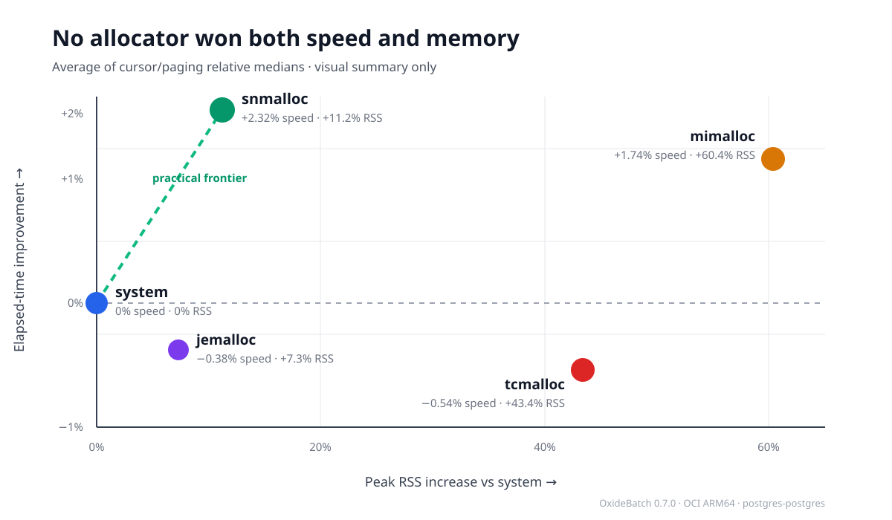
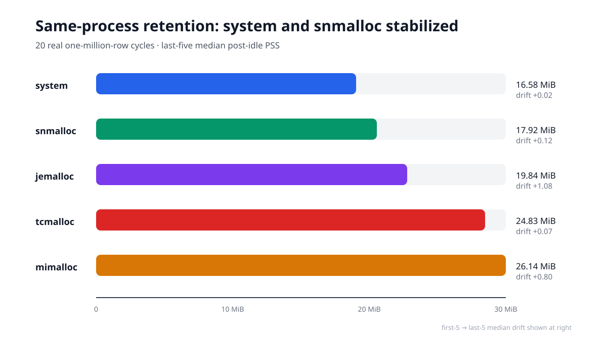

# Rust에서 커스텀 Allocator는 정말 더 빠를까?

Rust 서버나 배치 프로그램의 성능을 이야기하다 보면 `jemalloc`, `mimalloc`, `snmalloc`, `tcmalloc` 같은 커스텀 allocator 이름이 자주 나온다.

그래서 자연스럽게 이런 기대가 생긴다.

> 기본 allocator 대신 잘 만든 커스텀 allocator를 쓰면 더 빠르고, 메모리도 덜 쓰지 않을까?

OxideBatch에서도 같은 질문이 생겼다. 추측으로 기본값을 바꾸고 싶지는 않았다. 실제 batch workload에서 다섯 allocator를 같은 조건으로 돌리고, 실행 시간뿐 아니라 peak RSS와 장기 retention까지 확인했다.

결과는 기대보다 훨씬 덜 극적이었다.

**속도와 RSS를 동시에 개선한 allocator는 하나도 없었다.**

시각화의 좌표는 cursor/paging 상대값의 단순 평균으로 만든 요약값이다. 의사결정의 원본 수치는 아래 표처럼 reader별 결과를 따로 본다.

## 먼저 결론

이번 실험의 결론은 세 줄로 줄일 수 있다.

- **기본값은 system allocator를 유지한다.**
- **snmalloc은 메모리 여유가 있을 때 사용할 수 있는 성능 opt-in이다.**
- **jemalloc, mimalloc, tcmalloc은 이 workload에서는 기본값으로 바꿀 근거가 없었다.**

중요한 점은 “커스텀 allocator가 쓸모없다”가 아니다.

이번 workload에서 allocator 자체가 전체 성능을 지배하는 병목이 아니었고, allocator를 바꾸면 서로 다른 비용을 지불하게 된다는 것이 결과에 더 가깝다.

## 무엇을 측정했나

대상은 allocator microbenchmark가 아니라 OxideBatch의 실제 PostgreSQL 기반 대표 workload였다.

Claim-bearing 환경은 다음과 같다.

- OxideBatch: 정확히 공개된 `0.7.0`
- target: `aarch64-unknown-linux-gnu`
- host: OCI ARM64 `VM.Standard.A1.Flex`
- CPU: 4 OCPU
- RAM: 24 GB
- filesystem: ext4
- swap: off
- PostgreSQL: 18 계열
- 후보: `system`, `jemalloc`, `mimalloc`, `snmalloc`, `tcmalloc`

실험은 한 번의 숫자로 끝내지 않았다.

### Phase 4: canonical repeated benchmark

성능 비교의 기준이 되는 lane이다.

- source rows: 1,000,000
- seed: 20260904
- chunk: 1,000
- cursor fetch: 500
- paging page: 750
- warmup: reader별 2회
- measured: reader별 7회
- allocator 5종 × reader 2종
- measured manifest 70/70 PASS
- warmup correctness 20/20 PASS
- raw artifact hash 140개 검증
- outlier는 표시하되 삭제하지 않음

즉 “한 번 돌렸더니 빨랐다”가 아니라 같은 데이터와 같은 host에서 분포를 비교했다.

### Phase 5A: restart / quiescence

각 iteration마다 workload process를 새로 시작해 process-local allocator 상태를 끊었다.

allocator별 10 iteration을 실행하고 terminal success 이후 quiescence interval도 유지했다. 이를 통해 프로세스 종료 이후에도 남는 DB/metadata/filesystem 상태와 process-local allocator 상태를 구분했다.

### Phase 5B: same-process churn

가장 궁금했던 부분이다.

프로세스를 죽이지 않고 allocator별로 하나의 PID를 유지한 채 실제 100만-row job을 **20 cycle** 반복했다.

각 cycle은 다음과 같은 흐름을 가진다.

`run → projection 1,000,000 rows 확인 → business rows cleanup → idle → memory/native snapshot`

cursor와 paging은 10:10으로 번갈아 수행했다. 이 lane의 목적은 benchmark timing이 아니라 같은 process에서 allocation/free가 반복될 때 idle baseline이 계속 올라가는지를 보는 것이다.

## Phase 4 결과: 무료 점심은 없었다

실행 시간 median은 다음과 같았다.

| allocator | Cursor median | Paging median | system 대비 |
| --- | ---: | ---: | --- |
| system | 16.6972s | 16.6566s | baseline |
| snmalloc | **16.2908s** | **16.2901s** | **2.43% / 2.20% faster** |
| mimalloc | 16.3696s | 16.4029s | 1.96% / 1.52% faster |
| jemalloc | 16.7104s | 16.7673s | 0.08% / 0.67% slower |
| tcmalloc | 16.6922s | 16.8399s | 0.03% faster / 1.10% slower |

속도만 보면 snmalloc이 가장 좋다.

문제는 메모리다.

Median max RSS를 system과 비교하면:

| allocator | Cursor max RSS | Paging max RSS |
| --- | ---: | ---: |
| system | baseline | baseline |
| snmalloc | **+13.2%** | **+9.2%** |
| jemalloc | +8.4% | +6.2% |
| tcmalloc | +41.3% | +45.4% |
| mimalloc | **+58.5%** | **+62.3%** |

결과적으로 **속도와 RSS를 동시에 이긴 allocator는 없었다.**

snmalloc은 약 2%대의 시간을 줄이는 대신 peak RSS를 대략 10% 더 쓴다. mimalloc은 약간 빨라지지만 메모리 증가가 너무 컸다. tcmalloc은 메모리를 크게 더 쓰면서 시간 이득도 거의 없었다. jemalloc은 system과 실행 시간이 거의 같았지만 RSS는 더 컸다.

이번 workload에서 Pareto frontier에 남는 선택지는 사실상 system과 snmalloc 두 개였다.

## “할당/해제가 충분히 빡셌나?”

Phase 4 숫자만 보면 이런 의문이 남는다.

> 실제로 allocation/free를 충분히 많이 하지 않아서 allocator 차이가 안 난 것 아닐까?

이 질문 때문에 Phase 5B를 추가했다.

same-process lane에서는 실제 100만-row job을 한 process에서 20번 반복했다. row 처리 과정의 `String`, 변환 결과, projector clone, bind vector, source digest 계산 등 실제 workload 경로의 allocation/free가 그대로 반복된다.

그리고 매 cycle마다 business projection을 지운 뒤 1초 idle을 두고 PSS/RSS와 allocator-native telemetry를 기록했다.

20 cycle 이후의 post-idle PSS는 다음과 같다.

| allocator | first-5 median | last-5 median | median drift | late-10 slope |
| --- | ---: | ---: | ---: | ---: |
| system | 16.56 MiB | 16.58 MiB | +0.02 MiB | +0.001 MiB/cycle |
| snmalloc | 17.79 MiB | 17.92 MiB | +0.12 MiB | +0.003 MiB/cycle |
| jemalloc | 18.76 MiB | 19.84 MiB | +1.08 MiB | +0.143 MiB/cycle |
| tcmalloc | 24.76 MiB | 24.83 MiB | +0.07 MiB | 0.000 MiB/cycle |
| mimalloc | 25.34 MiB | 26.14 MiB | +0.80 MiB | +0.131 MiB/cycle |

snmalloc의 native `current_memory_usage`와 `peak_memory_usage`는 first-5와 last-5 median 사이에서 drift가 0이었다.

따라서 적어도 **이 실제 OxideBatch workload에서 snmalloc의 성능 이득이 장기적인 process-local memory growth를 숨긴 결과는 아니었다.**

jemalloc은 live allocated bytes 자체는 거의 평평했지만 OS-visible resident/mapped footprint가 20 cycle 안에서 명확하게 plateau했다고 보기 어려웠다. 이것만으로 leak이라고 부를 수는 없다.

mimalloc도 절대 footprint가 높고 후반부에 약한 상승 경향이 있었지만, 이 결과 역시 leak 판정은 아니다.

### 그래도 allocator torture test는 아니다

여기서 경계를 분명히 해야 한다.

이 실험은 **“OxideBatch의 실제 workload에서 어떤 allocator가 맞는가?”**를 검증한 것이다.

다음과 같은 allocator 전용 극단 상황을 일부러 만들지는 않았다.

- 매우 많은 thread가 동시에 작은 객체를 malloc/free
- cross-thread allocation/free
- 특정 size class에 집중되는 초고빈도 churn
- random lifetime으로 fragmentation을 극대화하는 패턴
- NUMA
- huge allocation / aggressive release
- allocator operation 자체의 P99/P999 latency

따라서 “snmalloc이 모든 Rust 프로그램에서 2% 빠르다”거나 “mimalloc은 항상 RSS를 60% 더 쓴다”는 결론은 이 데이터로 말할 수 없다.

반대로 OxideBatch의 default allocator를 결정하는 데 allocator torture test가 더 중요한 것도 아니다. 기본값은 실제 representative workload에서 판단해야 한다.

## 그럼 커스텀 allocator를 왜 쓰나?

이번 결과를 보고 가장 먼저 든 생각은 이것이었다.

> 이 정도면 커스텀 allocator를 만드는 이유가 대체 뭐지?

문제는 기대 모델에 있었다.

커스텀 allocator를 “system allocator보다 모든 면에서 좋은 대체품”으로 생각하면 이번 결과는 이상하다.

하지만 allocator는 보통 여러 비용 사이에서 trade-off를 선택한다.

allocation throughput을 높이기 위해 thread-local cache나 reservation을 공격적으로 가져갈 수 있고, contention을 줄이는 대신 메모리를 더 보유할 수 있다. fragmentation 관리나 특정 allocation pattern을 위해 다른 정책을 선택할 수도 있다.

즉 현실의 질문은 대개 다음에 더 가깝다.

> 어느 allocator가 더 좋은가?

가 아니라

> **내 workload가 어떤 비용을 더 중요하게 보는가?**

이번 workload에서는 그 답이 꽤 명확했다.

### system

가장 낮은 메모리 footprint와 가장 평평한 장기 baseline을 보였다.

실행 시간이 최상은 아니지만 차이가 크지 않았고, 별도 allocator dependency나 target별 정책을 기본값에 추가할 이유도 없다.

그래서 default로 유지했다.

### snmalloc

이번 실험에서 유일하게 분명한 performance option이었다.

cursor와 paging 양쪽 모두 약 2% 이상 빨랐고 same-process retention도 안정적이었다.

대신 peak RSS를 약 9~13% 더 쓴다.

따라서 메모리에 여유가 있고 job 처리시간을 조금이라도 줄이는 것이 가치가 있는 환경이라면 opt-in 선택으로 충분히 의미가 있다.

### jemalloc

이번 workload에서는 system과 시간 차이가 사실상 없었다.

RSS는 더 높았고 Phase 5에서는 OS-visible footprint가 약간 상승하는 모습도 남았다.

“서버니까 jemalloc”이라는 이유만으로 선택할 근거는 없었다.

### mimalloc

시간은 1~2% 정도 좋아졌지만 peak RSS가 약 58~62% 증가했다.

이번 workload에서는 비용 대비 이득이 맞지 않았다.

### tcmalloc

same-process idle baseline은 안정화됐지만 절대 footprint가 높았다.

Phase 4에서도 peak RSS가 40% 이상 늘었고 실행 시간의 일관된 이득은 없었다.

## 오히려 중요한 발견: allocator가 병목이 아니었다

snmalloc은 가장 좋은 실행 시간을 기록했지만 개선 폭은 약 2%대였다.

이 결과를 allocator가 전체 시간의 정확히 몇 퍼센트를 차지한다고 역산할 수는 없다. 하지만 적어도 **allocator 교체만으로 이 batch workload의 성능이 크게 달라지는 구조는 아니다**라는 것은 분명하다.

PostgreSQL 작업, row decode/transform, framework orchestration, digest 계산 등 전체 실행 경로가 훨씬 넓다.

그래서 allocator를 계속 미세 조정하기보다 실제 profile에서 더 큰 비중을 차지하는 경로를 찾는 것이 다음 최적화의 우선순위다.

## 최종 결정

OxideBatch 0.7.0의 이 workload와 ARM64 GNU/Linux 환경에서 내린 결정은 다음과 같다.

**Default**

`system`

**Performance opt-in**

`snmalloc`

**현재 증거로 default 비추천**

`jemalloc`, `mimalloc`, `tcmalloc`

이 결정은 snmalloc이 위험해서가 아니다. 오히려 Phase 5에서 장기 retention 우려는 상당 부분 해소됐다.

default로 올리지 않은 이유는 **약 2.2~2.4%의 성능 이득과 약 9~13%의 peak RSS 증가라는 trade-off**, 그리고 증거가 한 architecture와 한 representative workload에 한정되어 있기 때문이다.

## 이 실험에서 가장 유용했던 것

최종적으로 custom allocator를 기본값으로 채택하지 않았다.

겉으로 보면 많은 실험을 하고 “그냥 system 쓰자”로 끝난 셈이다.

하지만 이것이 벤치마크의 실패라고 생각하지 않는다.

실험 전에는 다음 질문이 계속 남아 있었다.

- jemalloc을 넣으면 서버 workload가 더 좋아지지 않을까?
- mimalloc이 더 빠른 것 아닐까?
- snmalloc의 성능 이득은 장시간 돌면 메모리 증가로 돌아오는 것 아닐까?
- system allocator를 그대로 쓰는 것이 단순히 아무것도 안 한 선택 아닐까?

이제는 이 질문들에 추측이 아니라 evidence로 답할 수 있다.

**벤치마크의 목적은 최적화를 정당화하는 것만이 아니다. 필요 없는 최적화를 제거하는 것도 중요한 결과다.**

이번에는 system allocator가 그 검증을 통과했다.

---

## Evidence boundary

이 글의 수치는 다음 범위에만 적용한다.

- OxideBatch `0.7.0`
- `postgres-postgres` representative workload
- OCI ARM64 / `aarch64-unknown-linux-gnu`
- 이 캠페인에서 고정한 dataset과 실행 geometry

다른 architecture, libc, allocator 버전, thread topology, workload allocation pattern에서는 결과가 달라질 수 있다.

공개 실험 기록:

- [Allocator campaign #323](https://github.com/luceat-lux-vestra/oxide-batch-workloads/issues/323)
- [Phase 4 canonical benchmark accepted evidence](https://github.com/luceat-lux-vestra/oxide-batch-workloads/issues/323#issuecomment-7042916850)
- [Phase 5 retained-evidence audit](https://github.com/luceat-lux-vestra/oxide-batch-workloads/issues/323#issuecomment-7058282776)
- [Final allocator decision](https://github.com/luceat-lux-vestra/oxide-batch-workloads/issues/323#issuecomment-7058948106)

Phase 4 summary SHA-256:

`938032fe04a00a366b3e0f9917398b19f997ac63d643f08ae017da8bd8aa4c20`

Phase 5A summary SHA-256:

`593afa55c1178db1e7d5b0ba041674d50e37ed996c04fbf3ca309cd0656054e0`

Phase 5B summary SHA-256:

`5422a392ba2133afa576883191132079068e97075d830eb79b4854cab41013a7`
